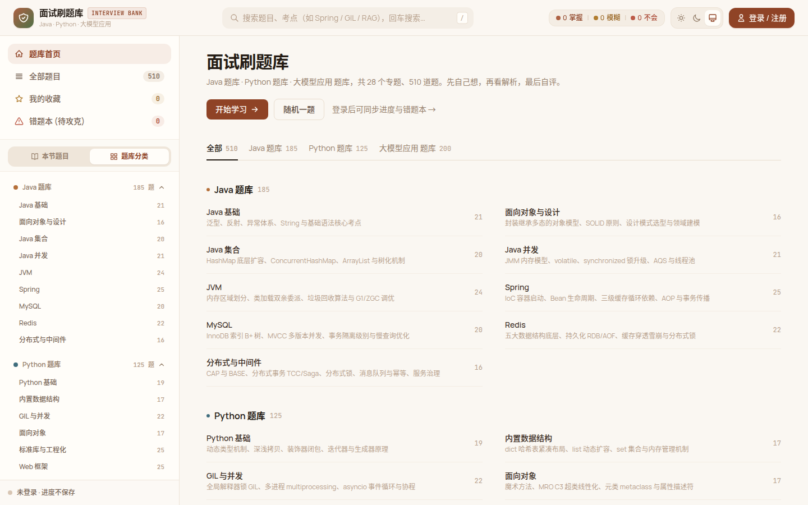
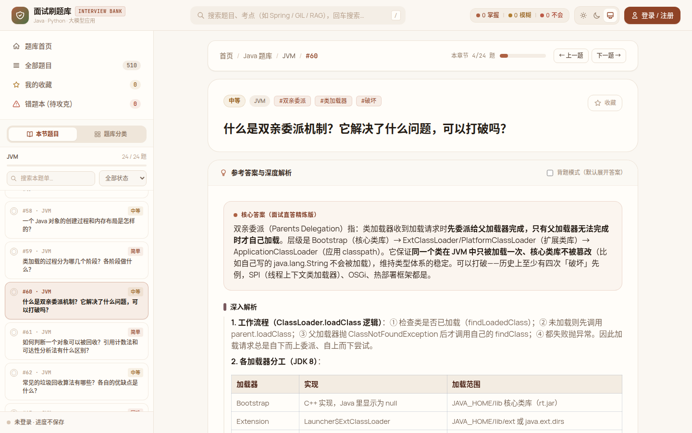
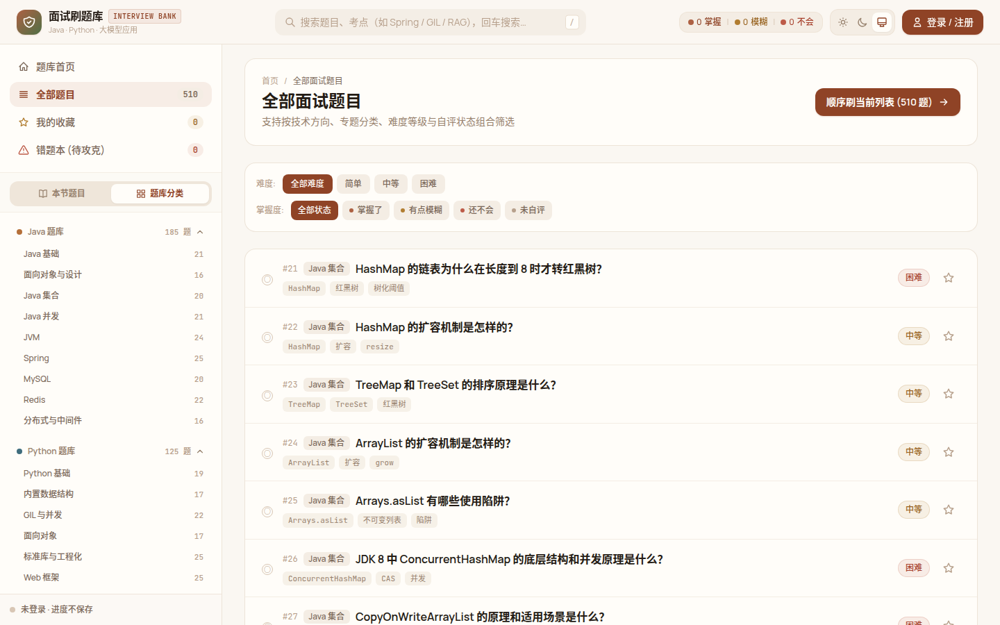
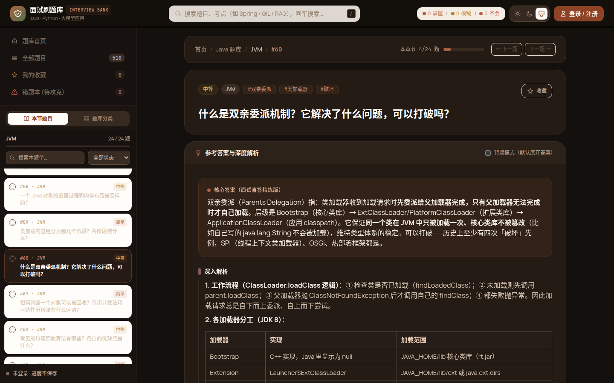
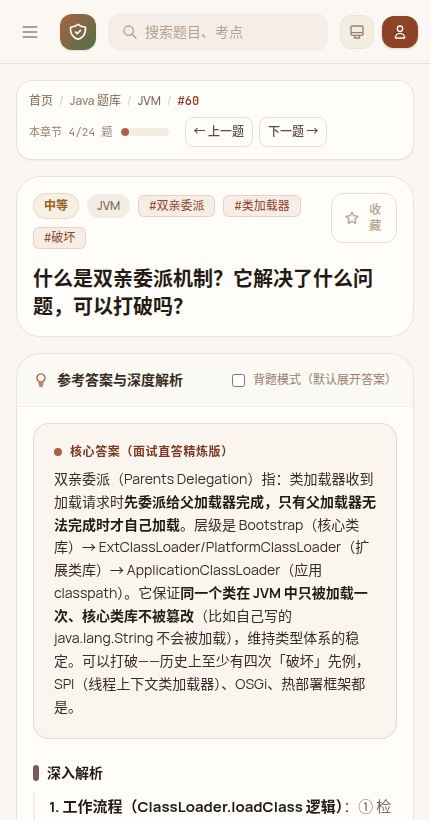
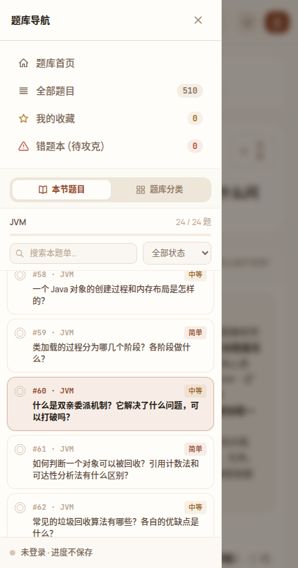

# 面试刷题库 · Vue 前端

[面试刷题库](https://mianshi.mxiao.top/) 的前端工程，面向 Java、Python 与大模型应用面试复习。使用 **Vue 3 + Vue Router + Pinia + Vite**，页面、公共组件、状态、接口与业务工具独立维护。

线上题库当前有 510 道题、28 个专题、3 条技术方向；题数由后端动态返回。本仓库只包含前端，不包含题目原始数据、账号服务或数据库。

## 界面预览

| 题库首页 | 题目详情 |
| --- | --- |
|  |  |

| 分页列表 | 深色模式 |
| --- | --- |
|  |  |

| 移动端详情 | 移动端侧栏 |
| --- | --- |
|  |  |

## 功能

- **继续学习**：记住上次学习题号，刷新后仍可从首页继续；没有记录时从当前方向第一道未掌握题开始。
- **章节导航**：上一题、下一题、小节进度；本节结束进入下一小节，最后一个小节返回题库。
- **章节侧栏**：详情页只列当前小节，当前题自动居中；同节换题保留列表节点和滚动连续性。
- **搜索与分页**：按标题、专题、标签搜索；难度与掌握度组合筛选，默认 10 题一页，页码与范围写入 URL。
- **收藏和自评**：登录后同步收藏及掌握状态，图标和统计即时更新；模糊、不会的题进入错题本。
- **答案阅读**：核心答案、深入解析、常见追问、代码示例；支持背题模式、表格横向滚动和复制代码。
- **亮色、深色、跟随系统**：主题、学习偏好、上次题号兼容旧版浏览器存储。
- **手机适配**：侧栏抽屉、遮罩、ESC 关闭和弹窗焦点管理。

## 开发

要求 Node.js **22.12+**（推荐 Node 24）和 npm。

```bash
git clone https://github.com/xiaocqaq/INTERVIEW_BANK_UI.git
cd INTERVIEW_BANK_UI
npm ci
npm run dev
```

浏览器打开终端显示的本机地址（默认 `http://127.0.0.1:5173`）。开发服务器将 `/api` 转发至 `http://127.0.0.1:8650`，可在 `vite.config.js` 中修改。**需要兼容的后端运行**：无后端时会显示加载错误与重试按钮，不会自动生成演示题。

```bash
npm run build       # 构建 dist，CSS 与字体一起打包
npm run preview     # 在 127.0.0.1:4173 预览生产产物，含 SPA 回退与 API 代理
```

预览后端可通过 `PROXY_TARGET=http://127.0.0.1:8650 npm run preview` 指定，预览端口使用 `PORT` 或 `npm run preview -- --port 4174`。预览程序只用于本地检查。

## 工程结构

```text
├── index.html                   # 入口壳，不存放业务逻辑
├── src/
│   ├── main.js                  # Vue、Pinia、路由与样式初始化
│   ├── App.vue                  # 布局、全局弹窗、加载与错误状态
│   ├── views/
│   │   ├── HomeView.vue          # 专题目录与继续学习
│   │   ├── QuestionListView.vue  # 列表、收藏、错题与筛选分页
│   │   └── QuestionDetailView.vue # 题目、章节导航与学习交互
│   ├── components/              # 顶栏、侧栏、筛选、分页、答案、自评、弹窗等
│   ├── composables/             # 顶栏滚动显隐
│   ├── stores/bank.js           # Pinia：题库、登录、收藏、进度、偏好
│   ├── services/api.js          # 请求、Bearer、错误与会话失效处理
│   ├── router/index.js          # History 路由，页面按需加载
│   ├── utils/                   # 章节顺序、继续学习、答案清洗与分节
│   ├── data/catalog.js          # 技术方向配置与专题简介
│   ├── styles/main.css          # Tailwind 指令、布局与答案排版
│   ├── clay.css                 # 赤陶主题
│   └── pygments.css             # 代码高亮
├── tests/unit/                  # 导航、继续学习、答案处理
├── tests/e2e/                   # Playwright 桌面与手机回归
├── scripts/preview.mjs          # 生产产物本地预览
└── vite.config.js               # 构建、开发代理与单元测试配置
```

不使用整页 HTML 字符串拼接或整页 `innerHTML` 重绘。筛选和收藏通过响应式状态更新，题目行用稳定的 ID 作为 key；换题复用详情页实例。只有后端返回的 Markdown HTML 使用 `v-html`，插入前经 DOMPurify 清洗。Tailwind 在构建时编译；字体本地打包，不依赖 Google Fonts 在线样式。

## 路由与状态

| 路径 | 页面 |
| --- | --- |
| `/` | 题库首页、继续学习、随机一题 |
| `/list` | 全部题目；支持 `q`、`cat`、`track`、`page` 查询参数 |
| `/q/:id` | 题目详情 |
| `/favorites` | 我的收藏（需登录） |
| `/wrongbook` | 错题本（需登录） |

例如 `/list?cat=java%2Fjvm&page=2` 可分享并刷新保持页码。无效页码会归到有效范围，换范围或筛选回到第一页；旧 `#/q/1` 链接会迁移到 History 路径。

浏览器 `mianshi_ui_prefs` 保存主题、展开状态、学习偏好和 `lastQuestionId`；`mianshi_token` 保存登录令牌。题目、自评与收藏由后端维护，退出登录会清除界面中的个人状态。详情只在当前会话内缓存，刷新重新获取。

键盘支持 `/` 聚焦搜索、`Space` 展开答案、`1/2/3` 自评、`ESC` 关闭弹窗或抽屉。输入框与弹窗打开时不会误触学习快捷键。

## 后端接口

默认同源 `/api`，JSON 响应；登录后携带 `Authorization: Bearer <token>`。

| 方法 | 路径 | 请求与响应 |
| --- | --- | --- |
| POST | `/api/auth/login` | 请求 `{username,password}`，响应 `{token,user}` |
| GET | `/api/auth/me` | 响应 `{user}`，需有效令牌 |
| GET | `/api/categories` | `{categories:[{lang,slug,name,count}]}`，顺序决定章节顺序 |
| GET | `/api/questions?page=1&page_size=200` | `{total,items:[...]}`，启动时分页拉取题目摘要 |
| GET | `/api/questions/{id}` | 题目详情，含 `answer_html` |
| POST | `/api/questions/{id}/record` | 请求 `{status:1}`；1 掌握、2 模糊、3 不会，需登录 |
| POST | `/api/questions/{id}/favorite` | 无请求体，响应 `{ok:true,favorite:true}`，需登录 |

题目摘要字段：`id`、`lang`、`category`（slug）、`title`、`difficulty`（1/2/3）、`tags`、`favorite`、`last_status`（null/1/2/3）、`in_wrong_book`。前端错题集合以 `last_status` 为 2 或 3 为准；统计由统一状态计算，不额外请求 `/api/stats`。分类与题目只读接口允许匿名；自评、收藏、用户信息需要登录。注册链接由登录弹窗引导至现有账号站。

答案 HTML 建议包含独占的 `h2`：核心答案、深入解析、常见追问、代码示例；代码高亮兼容 Pygments。分类由后端驱动，新增已有方向的专题会自动显示；简介可补在 `src/data/catalog.js`。新增技术方向需同时更新前后端配置。

## 部署

生产 `base` 为 **`/static/`**，与当前 FastAPI 静态目录约定一致。`dist/index.html` 必须作为站点根路径及 History 路由的入口，`dist/assets/` 对应线上 `/static/assets/`。

当前 FastAPI 部署：先备份现有静态目录；将 `dist/assets/` 复制到后端静态目录的 `assets/`，最后原子替换该目录的 `index.html`。不要只复制源码或只复制入口；旧 hash 资源应保留一段时间供已打开页面继续访问。静态文件更新无需重启 API 服务。

独立 nginx 托管示例（`root` 指向完整 `dist`）：

```nginx
server {
    listen 80;
    server_name mianshi.example.com;
    root /var/www/interview-bank/dist;
    index index.html;

    location /api/ {
        proxy_pass http://127.0.0.1:8650;
        proxy_set_header Host $host;
    }
    location /static/ {
        alias /var/www/interview-bank/dist/;
    }
    location / {
        try_files $uri $uri/ /index.html;
    }
}
```

入口建议使用 `Cache-Control: no-cache`，hash 资源可长缓存。更改挂载路径时需一起修改 Vite `base`、Vue Router 的 history base 与反向代理。

## 验证

```bash
npm test
npm run build
npx playwright install chromium
npm run test:e2e
```

如机器已有 Chromium，可设 `PLAYWRIGHT_EXECUTABLE_PATH=/path/to/chrome`。Playwright 默认启动生产预览，分别覆盖 1440×900 桌面与 430×820 手机；API 使用测试拦截，不会写入真实学习记录。无后端时也可执行这套回归。单元测试覆盖章节切换、继续学习、答案分节与脚本注入清洗；端到端覆盖分页、筛选、侧栏复用与居中、收藏、自评、继续学习、答案阅读、弹窗、搜索和移动端遮罩。

跨站主题同步脚本是可选增强，异步加载；不可用时仍能使用本站主题切换。网络异常显示重试，401 会清理过期会话；前端不提供完全离线题库。

## 许可

[MIT](./LICENSE) © xiaocqaq。依赖和打包字体遵循各自许可证。
