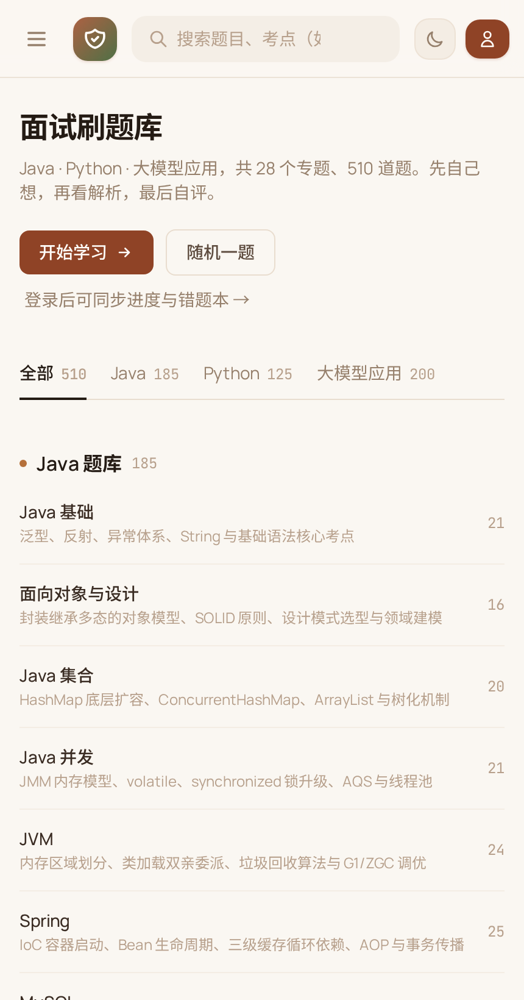

# 面试刷题库 · 前端

[mianshi.mxiao.top](https://mianshi.mxiao.top) 的前端源码。一个**零构建的单页应用**（Single Page Application）：没有打包器、没有 npm 依赖、没有编译步骤，浏览器直接跑源码 —— 克隆下来用任意静态服务器打开就能看到完整界面。

> 线上站点：<https://mianshi.mxiao.top> · 题库规模：**510 题 / 28 个专题 / 3 条技术方向**（Java 185 · Python 125 · 大模型应用 200）

---

## 目录

- [它长什么样](#它长什么样)
- [这个项目是什么](#这个项目是什么)
- [功能一览](#功能一览)
- [技术选型](#技术选型)
- [快速开始](#快速开始)
- [目录结构](#目录结构)
- [路由表](#路由表)
- [后端接口约定](#后端接口约定)
- [离线 / 演示模式](#离线--演示模式)
- [定制与改造](#定制与改造)
- [无障碍与移动端](#无障碍与移动端)
- [已知边界](#已知边界)
- [许可](#许可)

---

## 它长什么样

| 首页（继续学习） | 题目详情（含自评） |
| --- | --- |
|  |  |

| 题库列表（分页 10 题/页） | 深色模式 |
| --- | --- |
|  |  |

| 移动端首页 | 移动端详情 |
| --- | --- |
|  |  |

更多截图见 [`docs/screenshots/`](./docs/screenshots)。

---

## 这个项目是什么

面向前端面试复习的**刷题界面**。后端（FastAPI + PostgreSQL）负责题库、账号、自评与收藏的存储；本仓库只包含**纯前端**部分：页面结构、样式、路由、状态管理与所有交互逻辑。

设计目标是**沉浸式刷题**：一道题占一屏，先自己想，再看解析，最后自评；上下题、小节进度、错题本、收藏夹都在手边，不需要来回跳页。

---

## 功能一览

### 刷题主流程

- **首页即题库**：三条技术方向（Java / Python / 大模型应用）的专题目录，点专题直接进入该专题第一题。
- **继续学习**：首页主按钮记住你上次看到的那道题（存在 `localStorage`），点一下直接续上；没有记录时退化为「开始学习」，进入当前方向第一道未自评的题。
- **上一题 / 下一题**：详情页导航条随时切换，键盘 `←` `→` 同样可用。
- **下一小节**：当前小节最后一题时，按钮自动变成「下一小节 · XX 专题」，一节学完顺势往下走；整库最后一题则显示「返回题库」。
- **小节进度**：导航条显示「本章节 21 / 21 题」与进度条。

### 自评与复习

- **三档自评**：「掌握了 / 有点模糊 / 还不会」，快捷键 `1` `2` `3`，登录后同步到云端。
- **错题本**：自动收录自评为「有点模糊 / 还不会」的题，支持再按难度、掌握度筛选。
- **收藏夹**：列表页星星按钮一键收藏，图标即时变色，不需要刷新页面。
- **进度统计**：首页顶部展示已掌握 / 模糊 / 不会的数量与占比。

### 检索与筛选

- **全局搜索**：顶栏搜索框按标题、专题、标签模糊匹配，回车即搜。
- **列表筛选**：难度（简单 / 中等 / 困难）× 掌握度（掌握了 / 有点模糊 / 还不会 / 未自评）组合筛选；每行末尾有固定的「×」一键清除该行筛选。
- **分页**：全部题目默认 **10 题 / 页**，底部分页器支持页码直达、上一页 / 下一页，页码写进 URL（`?page=3`）可直接分享或刷新保持。
- **侧栏「本节题目」**：左侧列表只展示当前所在小节，跟着当前题自动切换范围。

### 外观与体验

- **亮 / 暗 / 跟随系统** 三种主题，跨子域与 mxiao.top 其他站点同步。
- **响应式**：1440 桌面 / 1024 平板 / 430 手机三档布局，移动端侧栏抽屉式滑出。
- **无抖动刷新**：切换筛选、收藏、翻页只替换 DOM 内容，不做整页淡入动画。
- **Markdown 渲染**：题目解析支持标题、列表、表格、代码块（Pygments 高亮）与行内代码。
- **自定义弹窗**：退出登录等确认场景使用站内弹窗，而非浏览器原生 `confirm`。

---

## 技术选型

| 方面 | 选择 | 说明 |
| --- | --- | --- |
| 框架 | **无** | 原生 DOM + 模块级函数，没有 React / Vue |
| 构建 | **无** | 源码即产物，改完刷新即可见 |
| 样式 | **Tailwind CSS 3.4（CDN 运行时版）** + 2 个 CSS 变量主题文件 | `tailwind.config` 在 `index.html` 内联定义品牌色与字体 |
| 路由 | 自制 History API 路由 | `/list`、`/q/584` 这类干净路径，`popstate` 双向同步 |
| 状态 | 模块内 `state` 对象 + `localStorage` | 只持久化主题、展开状态、上次学习的题号等轻量偏好 |
| Markdown | 后端渲染后回传 HTML | 前端只负责插入与 `wrapAnswerTables()` 包裹宽表格 |
| 依赖 | 仅 1 个本地脚本（Tailwind） | 无 npm、无 CDN 备用、无字体图标库 |

**为什么不用框架？** 这个界面只有 5 个路由、一个列表和一套详情页，用原生 DOM 做**增量化更新**（例如切题只改高亮那一行、收藏只换一个 SVG 的 `fill`）反而比虚拟 DOM 更容易做到「零闪烁」。代价是状态与渲染要自己管，所以关键列表都带了签名缓存（`SIDEBAR_LIST_SIG`）避免无谓重建。

---

## 快速开始

### 方式一：直接看界面（不需要后端）

```bash
git clone https://github.com/xiaocqaq/INTERVIEW_BANK_UI.git
cd INTERVIEW_BANK_UI/src
python3 -m http.server 8000
# 浏览器打开 http://localhost:8000
```

因为没有后端，列表会是空的、搜索无结果，但**布局、主题、响应式、路由跳转**都能正常查看。想在无后端时看到内容，见「[离线 / 演示模式](#离线--演示模式)」。

### 方式二：接你自己的后端

前端默认向**同源**的 `/api/*` 发请求，把 `src/` 交给任意静态服务器，再用反向代理把 `/api` 指到你的后端即可。例如 nginx：

```nginx
server {
    listen 80;
    server_name mianshi.example.com;
    root /path/to/INTERVIEW_BANK_UI/src;
    index index.html;

    location /api/ {
        proxy_pass http://127.0.0.1:8650;
        proxy_set_header Host $host;
        proxy_set_header X-Real-IP $remote_addr;
    }

    # SPA 回退：/list、/q/1、/favorites 等路径都交给 index.html
    location / {
        try_files $uri $uri/ /index.html;
    }
}
```

后端只要实现下面「[后端接口约定](#后端接口约定)」里的几个接口，前端即可完整工作。

### 方式三：部署到你自己的服务器

```bash
rsync -av --delete src/ user@your-server:/var/www/interview-bank/
```

静态资源全部走相对/绝对路径 `/static/...`，只要保证站点根目录下 `static/` 指向 `src/` 即可；不想改路径的话，把 `index.html` 里的 `/static/xxx` 前缀替换成你自己的目录。

---

## 目录结构

```
INTERVIEW_BANK_UI/
├── README.md                     # 本文档
├── LICENSE                       # MIT
├── .gitignore
├── src/
│   ├── index.html                # ★ 唯一页面：结构 + Tailwind 配置 + 全部业务 JS（约 3180 行）
│   ├── clay.css                  # 主题层：赤陶暖棕配色、字体、代码高亮覆盖（当前线上使用）
│   ├── pygments.css              # 代码块高亮配色
│   └── tailwind.3.4.17.js        # Tailwind CSS 运行时（本地副本，避免外网依赖）
└── docs/
    └── screenshots/              # 界面截图（亮色 / 暗色 / 移动端）
```

> **为什么业务代码全在一个文件里？** 这个项目刻意不做构建：`index.html` 里一段 `<script>` 就是全部逻辑（约 2500 行），省掉了打包产物与源码不一致的问题。代价是可读性一般，因此下方给出了「[代码地图](#代码地图)」帮你快速定位。

### 代码地图

`src/index.html` 内的脚本按编号分区，搜索注释里的编号即可跳转：

| 区块 | 内容 |
| --- | --- |
| 1–3 | 常量、`state` 状态对象、`localStorage` 读写 |
| 4 | 工具函数（`escapeHtml`、`showToast`、主题、确认弹窗 `askConfirm`） |
| 5 | API 封装 `API.req()` 与 `loadCategories` / `loadAllQuestions` |
| 6–8 | 侧栏分类树、侧栏题目列表（含增量化渲染与居中定位）、History 路由 |
| 9 | 首页视图 `renderHomeView()`、继续学习逻辑 `heroTargetQuestion()` |
| 10 | 列表视图 `renderQuestionListView()`、分页器 `listPagerNumbers()` |
| 11 | 详情视图 `renderQuestionDetailView()`、上一题 / 下一题 / 下一小节 |
| 12–13 | 全局搜索、登录注册与用户会话 |

---

## 路由表

使用 History API，路径即 URL，可直接分享与刷新：

| 路径 | 页面 | 说明 |
| --- | --- | --- |
| `/` | 首页 | 专题目录 + 继续学习 / 随机一题 |
| `/list` | 全部题目 | 支持 `?q=关键词`、`?cat=java/jvm`、`?page=3` |
| `/q/:id` | 题目详情 | 答案解析、自评、收藏、上下题 |
| `/favorites` | 我的收藏 | 需要登录 |
| `/wrongbook` | 错题本 | 需要登录，自动收录模糊 / 不会 |

旧版哈希路由（`#/wrongbook`）会自动迁移到干净路径，收藏夹里的老地址不会失效。

---

## 后端接口约定

前端只依赖下面这些接口，全部以同源 `/api` 为前缀，响应为 JSON：

| 方法 | 路径 | 用途 |
| --- | --- | --- |
| `POST` | `/api/auth/login` | 登录，返回 `token` 与用户信息 |
| `GET` | `/api/auth/me` | 校验当前 token，返回用户信息 |
| `GET` | `/api/categories` | 专题分类树（决定侧栏与专题目录顺序） |
| `GET` | `/api/questions?page=&page_size=` | 题目分页列表 |
| `GET` | `/api/questions/{id}` | 题目详情，`answer_html` 为后端渲染好的 Markdown |
| `POST` | `/api/questions/{id}/record` | 提交自评（`mastered` / `fuzzy` / `unknown`） |
| `POST` | `/api/questions/{id}/favorite` | 切换收藏 |
| `GET` | `/api/stats` | 用户进度统计 |

请求头 `Authorization: Bearer <token>` 为登录态凭证。除登录外的接口在匿名状态下也应可用（返回 `favorite: false`、`last_status: null`）。

---

## 离线 / 演示模式

想在**没有后端**的情况下看到有内容的界面，最简单的做法是给 `API.req()` 加一层本地数据垫片。在 `src/index.html` 的 `API` 定义附近插入：

```js
// 演示模式：拦截 /api/questions 与 /api/categories，返回内置样例
const DEMO = {
  categories: [{ lang: 'java', slug: 'basics', name: 'Java 基础', count: 2 }],
  questions: [
    { id: 1, lang: 'java', category: 'basics', title: '== 和 equals() 的区别是什么？',
      difficulty: '简单', tags: ['操作符', 'equals'], favorite: false, last_status: null },
    { id: 2, lang: 'java', category: 'basics', title: 'String、StringBuilder、StringBuffer 有什么区别？',
      difficulty: '简单', tags: ['String', '不可变'], favorite: false, last_status: null }
  ]
};
```

更省事的办法：直接用 [Mock Service Worker](https://mswjs.io/) 或在浏览器 DevTools 里用 `fetch` 覆盖。**注意**：演示数据只用于本地预览，不要提交到线上分支。

---

## 定制与改造

### 换配色

站点视觉集中在 `src/clay.css`（当前线上主题）。文件顶部的 CSS 变量控制全局颜色：

```css
:root {
  --bg: #f6f7f2;          /* 页面底色 */
  --brand: #8f4326;       /* 品牌主色（赤陶暖棕） */
  /* … */
}
```

改这几个变量即可整体换肤；Tailwind 里的 `brand-*` 色阶在 `index.html` 的 `tailwind.config` 中单独定义，需要一起改。

### 换题目数据源

前端不关心题库从哪来，只要 `/api/questions` 与 `/api/categories` 的字段对得上即可。字段形状可参考 `decorateQuestion()` 与 `loadCategories()`。

### 加一个新专题

前端**不需要改代码**：专题目录与侧栏都由 `/api/categories` 驱动，只要后端返回新分类，界面自动出现。

---

## 无障碍与移动端

- 关键按钮都有 `aria-label` 或可见文字；确认弹窗支持 `Esc` 关闭。
- 键盘操作：`/` 聚焦搜索框，`Space` 展开答案，`1` `2` `3` 提交自评（需登录），`Esc` 关闭弹窗或让输入框失焦。
- 移动端（≤1024px）侧栏改为抽屉，顶栏汉堡按钮打开，点遮罩关闭。
- 无横向滚动；表格在窄屏下由 `wrapAnswerTables()` 包裹为可横向滚动的容器。

---

## 已知边界

- **无构建**是刻意的取舍：`index.html` 单文件较大（约 158 KB / 3180 行），不适合多人同时大改，也不做代码分割。
- 前端不缓存题目内容，切换路由会重新请求详情。
- 统计数字、进度条等依赖登录态；匿名访问时显示为 0。
- 主题同步依赖外部的 `theme-sync.js`，离线打开时主题切换只在当前页面生效。

---

## 许可

[MIT](./LICENSE) © xiaocqaq
